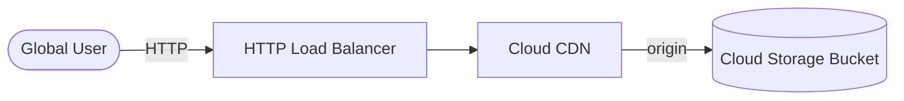

# GCP Global Static Hosting + CDN (Terraform)

> A static website on Cloud Storage, served globally through Cloud CDN behind an HTTP Load Balancer — provisioned with Terraform.
> **Author:** Muhammad Ahmad · **IaC:** Terraform · **Cloud:** GCP


---

## 📌 Overview

- A **Cloud Storage bucket** holds the site content (sample `index.html` / `404.html` uploaded by Terraform).
- A **backend bucket with Cloud CDN** caches content at Google's edge.
- A **global HTTP Load Balancer** (global IP → proxy → URL map → backend bucket) serves users worldwide.

## 🏗️ Architecture

> 🎨 **Interactive diagram (industry-standard icons):** [open in Lucid — page 25](https://lucid.app/lucidchart/3da75ce3-ea66-4296-81b3-00d20a60435b/edit)



## 🚀 Deploy

```bash
cd terraform
gcloud auth application-default login
terraform init
terraform apply -var="project_id=YOUR_PROJECT_ID"

terraform output cdn_url
```

## 🧹 Clean up

```bash
terraform destroy -var="project_id=YOUR_PROJECT_ID"
```

## 💰 Cost note

Storage and CDN egress are cheap for a small site; the load balancer forwarding rule has a small hourly fee.

## 🔐 Production hardening (next steps)

- Add **HTTPS** with a Google-managed SSL certificate.
- Add a **custom domain** and Cloud DNS.
- Add **Cloud Armor** for edge security.

---

*Built and maintained by **Muhammad Ahmad**.*
