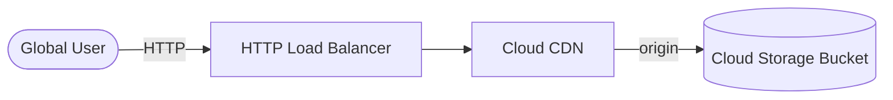

# Architecture Diagram — GCP Static Hosting + CDN

## Lucid diagram

- **Master Lucid document (all 30 diagrams, icon style):** https://lucid.app/lucidchart/3da75ce3-ea66-4296-81b3-00d20a60435b/edit
- This project is **page 25** of that document.

## Lucid prompt (reusable)

```
Create a GCP architecture diagram titled "GCP Global Static Hosting + CDN".
A Global User sends HTTP traffic to an HTTP Load Balancer; the load balancer uses
Cloud CDN, which caches content from a Cloud Storage bucket origin. Label the arrows.
Clean, professional Google Cloud colors.
```

## Mermaid source


